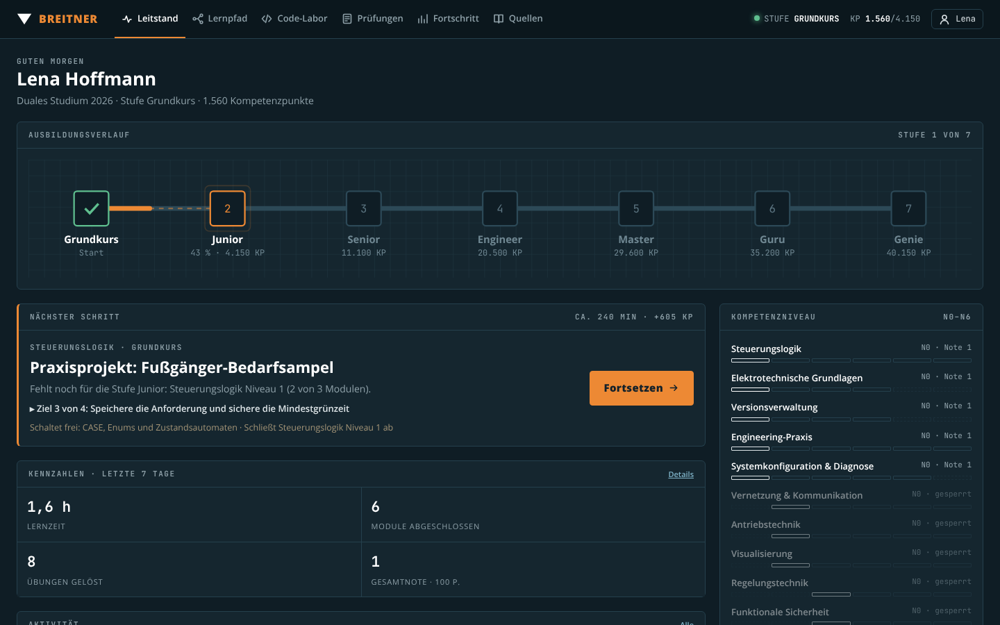

# BREITNER · ST Engineer

Lernplattform für SPS-Programmierung mit **B&R Automation Studio 6** in **Structured Text** – für Berufsschüler, Duale Studenten und Mitarbeiter.
Vom **Grundkurs** über **Junior, Senior, Engineer, Master, Guru** bis **Genie**. Jede Stufe verlangt mehr Bereiche auf höherem Niveau und eine bestandene Stufenprüfung.

Die Plattform läuft auf einem Rechner im Firmennetz und wird im Browser bedient. Sie speichert alle Lernstände in **einer** SQLite-Datenbank und bewertet serverseitig. Admins und Ausbilder sehen genau, was jemand kann und was noch nicht.



## Inhalt

| Bereich | Niveaus | Module | Übungen | Fragen | Videos | Texte |
|---|---|---|---|---|---|---|
| Steuerungslogik | N1–N6 | 16 | 25 | 107 | 45 | 48 |
| Elektrotechnische Grundlagen | N1–N4 | 13 | 16 | 89 | 37 | 32 |
| Versionsverwaltung (git bash, TortoiseGit) | N1–N4 | 12 | 22 | 83 | 35 | 36 |
| Engineering-Praxis | N1–N6 | 16 | 16 | 111 | 46 | 48 |
| Systemkonfiguration & Diagnose | N1–N5 | 13 | 17 | 85 | 37 | 39 |
| Vernetzung & Kommunikation | N2–N6 | 14 | 15 | 91 | 42 | 42 |
| Antriebstechnik | N2–N6 | 14 | 18 | 97 | 42 | 42 |
| Visualisierung (mapp View) | N2–N6 | 13 | 16 | 92 | 35 | 39 |
| Regelungstechnik | N3–N6 | 13 | 17 | 84 | 37 | 36 |
| Funktionale Sicherheit | N3–N6 | 12 | 13 | 83 | 33 | 35 |
| **Summe** | | **136** | **175** | **922** | **389** | **397** |

Dazu gibt es den **Elektro-Kompetenzcheck** mit 80 Fragen in 8 Kategorien. Je Versuch werden 48 Fragen gezogen, 40 davon haben zufällige Zahlenwerte. Das Niveau entspricht einem ausgelernten Elektroniker für Automatisierungstechnik, und der Check ist Pflicht für die Stufe Junior.

Jedes Modul besteht aus:
- Einführung, Praxisbezug und Umsteiger-Hinweisen für TIA Portal und CODESYS
- 2–3 Videos: Jede ID wurde per oEmbed geprüft, Titel und Kanal stammen exakt aus der Antwort.
- 2–3 Texten: Uni-Skripte zuerst. Jede URL wurde geprüft (HTTP 200), dazu gibt es eine Quellenangabe im APA-Stil mit Abrufdatum.
- 3–5 Zielen mit Schritt-für-Schritt-Anleitung
- ST- oder Git-Übungen mit automatischen Tests
- einer Wissensprüfung mit 3 Fragen
- weiteren Fragen für die Stufenprüfungen
- bei Praxisprojekten: Nachweis-Link und Abzeichen

## Installation

Voraussetzung ist **Node.js 22.13 oder neuer** (LTS 22 oder 24). Weitere Pakete braucht es nicht, auch keinen Internetzugang: Schriften und alle Skripte liegen lokal. Nur Videos und externe Texte öffnen YouTube bzw. die Quellseiten.

**Windows:** Ordner kopieren, `start.bat` doppelklicken und im Browser `http://<rechnername>:8080` öffnen.

**Linux:**

```bash
./start.sh
```

Anderer Port oder Datenordner:

```bash
PORT=80 DATA_DIR=/srv/bse-data node server/server.js
```

**Beim ersten Aufruf** legst du das Admin-Konto an. Danach erstellst du unter **Ausbildung › Konten & Gruppen** die Gruppen (Berufsschule, Duales Studium, Mitarbeiter), die Ausbilder und die Lernenden. Jede neue Person bekommt ein Startpasswort und legt beim ersten Login ein eigenes fest.

### Als Dienst betreiben

- **Windows:** Aufgabenplanung › „Beim Systemstart“ › Programm `node.exe`, Argument `server\server.js`, Starten in: Projektordner. Alternativ geht ein Dienst-Wrapper wie NSSM.
- **Linux (systemd):**

```ini
[Unit]
Description=becomeStEngineer
After=network.target
[Service]
WorkingDirectory=/opt/becomestengineer
ExecStart=/usr/bin/node server/server.js
Environment=PORT=8080 DATA_DIR=/var/lib/becomestengineer
Restart=always
User=bse
[Install]
WantedBy=multi-user.target
```

### Datensicherung

- Die Datenbank liegt in `data/becomestengineer.db`, solange du kein `DATA_DIR` setzt.
- Jeden Tag nach 2 Uhr entsteht automatisch eine Sicherung in `data/backups/`. Die letzten 30 bleiben erhalten.
- Unter **Ausbildung › Export & System** kannst du sofort sichern.
- **Wiederherstellen:** Server stoppen, die Sicherung als `becomestengineer.db` zurückkopieren, Server starten.

## Rollen

| Rolle | Sieht und darf |
|---|---|
| **Admin** | alle Personen und Gruppen, Konten und Rollen verwalten, Ausbilder Gruppen zuordnen, Nachweise bestätigen, CSV-Export, Sicherung, Inhalte neu laden |
| **Ausbilder** | nur die zugeordneten Gruppen: Bewertung, Personenberichte, Code der Lernenden, Nachweise bestätigen, Lernende anlegen |
| **Lernende** | den eigenen Lernstand vollständig. Musterlösungen erst nach dem Lösen. |

Der **Personenbericht** enthält:
- „Kann“, „Kann noch nicht“ und Schwachstellen
- Kompetenzringe und eine Notenmatrix aus Bereich × Niveau
- jede Übung mit Anzahl der Prüfungen, Übersetzungsfehlern, häufig fehlgeschlagenen Tests und dem Code
- falsch beantwortete Fragen
- Prüfungen, Lernzeit pro Woche, Wochenrückblicke und Aktivität

Über „Zeugnis drucken“ entsteht ein Leistungsnachweis mit Unterschriftszeilen.

## Bewertung

**Bewertet wird auf dem Server.** Der Browser bekommt keine Lösungen und keine richtigen Antworten, bevor eine Aufgabe bestanden ist. Die ST-Übungen laufen zur Bewertung im selben Interpreter auf dem Server, Git-Übungen werden dort aus der Befehlsfolge nachgespielt.

**Modulnote**
- Code-Übungen zählen **70 %**, die Wissensprüfung **30 %**.
- Eine Übung bringt beim Lösen 100 Punkte. Jede fehlgeschlagene Prüfung davor kostet 5 Punkte, mindestens 60 Punkte bleiben.
- Das Quiz bringt beim ersten Versuch 100 Punkte. Jeder weitere Versuch kostet 15 Punkte, mindestens 50 bleiben. Bestanden ist es nur mit allen Antworten richtig.
- Eine Note gibt es erst, wenn das Modul abgeschlossen ist.

**Noten nach IHK-Schlüssel**

| Punkte | Note |
|---|---|
| ab 92 | 1 |
| ab 81 | 2 |
| ab 67 | 3 |
| ab 50 | 4 |
| ab 30 | 5 |
| darunter | 6 |

**Niveau N1–N6 je Bereich:** Ein Niveau ist erreicht, wenn alle Lektionen und Projekte bis zu diesem Niveau abgeschlossen sind. Zusatzmodule zählen nicht dazu und bringen nur Bonus-KP. Praxisprojekte zählen erst, wenn der Ausbilder den Nachweis-Link bestätigt hat.

**Kompetenzpunkte (KP):** Sie werden immer aus dem Zustand berechnet, nie gespeichert.

| Ereignis | KP |
|---|---|
| Ziel | 15 |
| Quiz | 40 |
| Übung | 60 |
| Modulabschluss | 75 |
| Praxisprojekt | +400 |
| Zusatzmodul | +50 |
| bestandene Prüfung | 250 |

### Stufen

| Ziel-Stufe | Anforderungen |
|---|---|
| **Junior** | Logik, Elektro, Git, Praxis und System auf N1, dazu der **Elektro-Kompetenzcheck** |
| **Senior** | Logik, Elektro, Git, Praxis und System auf N2, dazu Kommunikation, Antriebstechnik und Visualisierung auf N2 |
| **Engineer** | alle Bereiche auf N3 |
| **Master** | alle Bereiche auf N4 |
| **Guru** | alle Bereiche auf N5 |
| **Genie** | alle Bereiche auf N6 |

Für jede Stufe kommen zwei Bedingungen dazu:
- eine **KP-Schwelle**: 80 % der bis dahin erreichbaren Punkte
- eine bestandene **Stufenprüfung** mit mindestens 50 Punkten

Die Stufenprüfung hat 16 + 2·Stufe Fragen aus den Prüfungspools der geforderten Bereiche und 2–3 ST-Programmieraufgaben aus anderen Bereichen. Code zählt 60 %, Fragen 40 %. Es gibt kein Zeitlimit.

**Prüfung vorziehen:** Wer schon Erfahrung hat, kann die Prüfung der nächsten Stufe jederzeit ablegen. Bestanden ist sie dann erst ab **67 Punkten**. Die Stufe gilt danach als „per Prüfung anerkannt“, und die Inhalte darunter gelten als erfüllt.

**Freischaltung:** Module eines Niveaus öffnen sich, wenn
- die eigene Stufe das Niveau erreicht hat,
- das vorige Niveau im Bereich erfüllt ist,
- und alle Voraussetzungen (`req`) abgeschlossen sind.

Gesperrte Module kann man trotzdem lesen.

## Code-Labor

Ein **eigener ST-Interpreter** (`public/js/st/`) bildet ein B&R-Projekt nach:
- Programmaufbau mit `PROGRAM _INIT / _CYCLIC / _EXIT`
- Dateien `Main.st`, `Variables.var` und `Types.typ`
- Task-Klasse mit Zykluszeit, Watch-Fenster und Zykluszeitverletzung bei Endlosschleifen
- strenge Typprüfung wie in AS6, mit deutschen Fehlermeldungen und Zeilensprung

Unterstützt werden:
- Strukturen, Enums, Arrays und Strings
- eigene FUNCTION und FUNCTION_BLOCK, Aktionen
- IEC-Standardbausteine und -Funktionen
- `ADR`, `SIZEOF` und die AsBrStr-Funktionen

Für die Übungen gibt es vereinfachte Nachbildungen von B&R-Bausteinen:
- MpAxisBasic und PLCopen MC_*
- MTBasicsPID, PT1 und PWM
- AsTCP mit einer simulierten Gegenstelle
- MpAlarmX

Die Szenen sind animiert: Förderband, Tank, Achse, Ampel, Zylinder, Leuchtmelder und Motor. Jede Übung hat eine Anlagen-Simulation in ST.

Der **Git-Simulator** (`public/js/gitsim.js`) bildet git bash nach:
- clone, branch, merge mit echten Konflikten, push und pull gegen ein simuliertes `git.breitner.de`, tags, stash, revert, reset
- `.gitignore`
- einen Mini-Editor

Grenzen:
- **Echtes Automation Studio und echte mapp-Komponenten sind nicht nachgebildet.** Was nur dort geht, steht als Schritt-für-Schritt-Anleitung im Modul, z. B. Hardware-Konfiguration, mapp View-Editor oder SafeDESIGNER.
- Im Simulator nicht verfügbar sind `REFERENCE TO` und Pointer-Arithmetik sowie bei Git `rebase`, `cherry-pick`, `bisect` und Submodule. Diese Themen stehen als Anleitung für die echte Umgebung im Modul.
- Fehlercodes, Zeitverhalten und Statuswerte der nachgebildeten Bausteine sind vereinfacht. Die Übungen nutzen deshalb nur Konstantennamen.

## Inhalte erweitern

Das Schema für alle Inhalte steht in [`docs/CONTENT_SCHEMA.md`](docs/CONTENT_SCHEMA.md). Die Inhalte liegen als Datendateien in `content/areas/<bereich>.js`, aufgeteilt in `content/areas/<bereich>/level*.js`.

```bash
npm test
```

Die einzelnen Prüfungen:

```bash
node tools/validate-content.js
```

```bash
node tools/check-exercises.js -v
```

```bash
node tools/e2e-stage.js
```

```bash
node tools/verify-sources.js
```

- `npm test` startet alle drei Prüfungen ohne Internet.
- `validate-content.js` prüft die Struktur: IDs, `req`, Anzahl Anleitungen = Anzahl Ziele.
- `check-exercises.js` prüft, dass jede Musterlösung alle Tests besteht und kein Startcode alle besteht.
- `e2e-stage.js` spielt den Weg einer Person vom Grundkurs zu Junior über die API durch.
- `verify-sources.js` prüft Videos und URLs. Dafür braucht es Internet.

Nach Änderungen: **Ausbildung › Export & System › Inhalte neu laden**, ein Neustart ist nicht nötig.

## Projektaufbau

```
server/server.js       HTTP-Server, SQLite-Schema, API (Login, Fortschritt, Prüfungen, Admin)
server/engine.js       Bewertung: KP, Niveaus, Noten, Stufen, nächster Schritt, Prüfungszusammenstellung
public/js/st/          ST-Interpreter (Parser, Compiler, Laufzeit, Bibliothek) – Browser und Node
public/js/gitsim.js    Git-Simulator – Browser und Node
public/js/*.js         Oberfläche (klassische Skripte, kein Build)
content/               Lehrplan, Fragen, Übungen, Quellen (Datendateien)
tools/                 Prüfwerkzeuge
docs/                  Inhalts-Schema, Design-Entwürfe, Screenshots
```

Hinweis: Inhalte zu Recht, Normen und Sicherheit dienen der Orientierung und sind keine Rechts- oder Sicherheitsberatung.
